<!-- Gerado por generator/build.py — edite generator/config.json e rode o script de novo -->



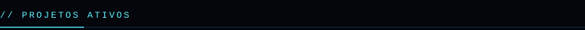

<a href="#">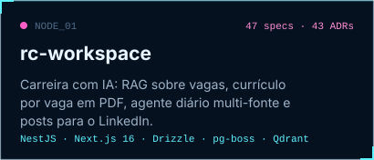</a>
<a href="#">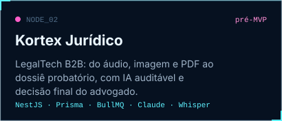</a>

<a href="https://github.com/Renatocff-bkp/coders-university-module-04">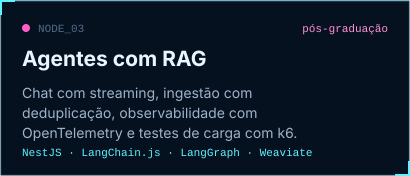</a>
<a href="https://github.com/Renatocff-bkp/machine-learning-treinamento-ia-nativo">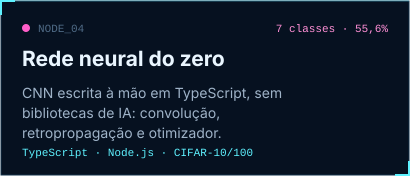</a>

<a href="#">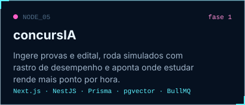</a>
<a href="#">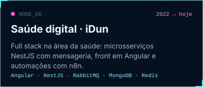</a>

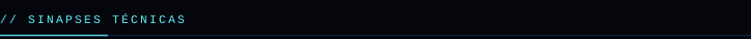

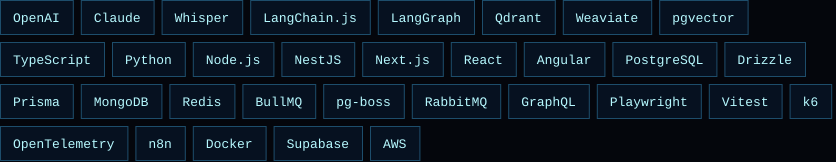

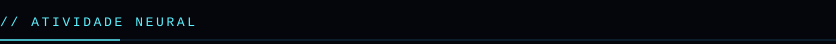

<picture>
  
</picture>

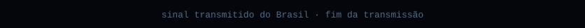

